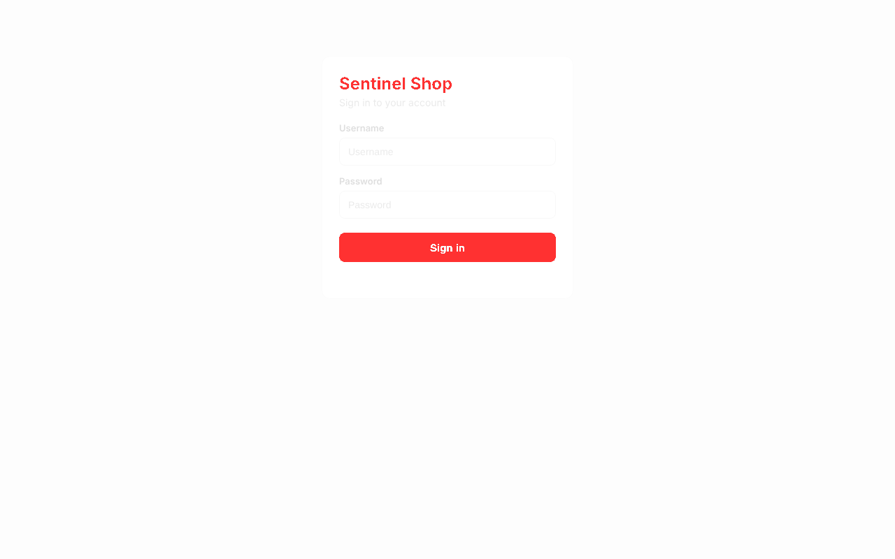
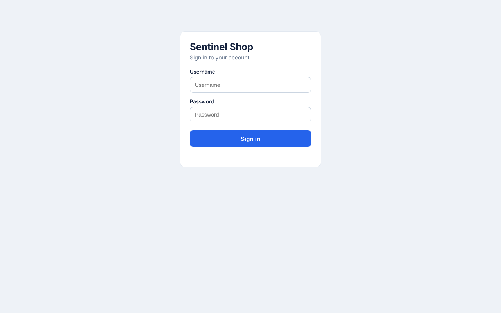
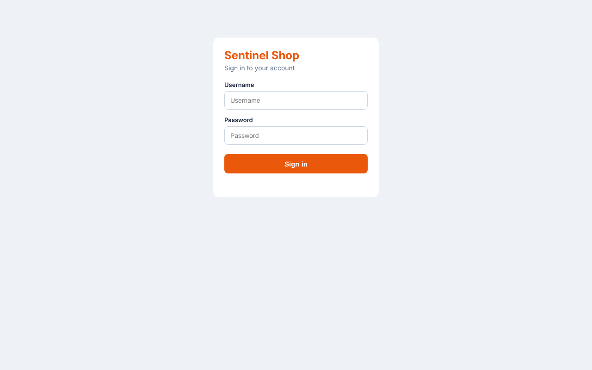

# Sentinel — Visual Regression & Self-Healing Test Automation

AI-style test tooling built on **Playwright (Node.js)**: catch unintended UI
changes with perceptual **visual regression**, and keep tests alive when the
markup changes with **self-healing locators** — all with **one dependency**
(Playwright) and a tiny self-contained demo app to test against.



*The diff above was generated by the engine: `?ui=v2` recoloured the heading and
the button, and those exact pixels are flagged red while everything unchanged is
faded out.*

---

## Why this project

Two of the most expensive problems in UI test suites are **false failures from
tiny visual drift** and **brittle locators that break on every refactor**. This
project tackles both the way modern AI-assisted tools (Applitools, Testim,
Healenium, Mabl) do — and implements the core ideas from scratch so the
mechanism is visible, not a black box:

- **Visual regression** — screenshot, compare against a baseline with a
  perceptual (YIQ) pixel metric that ignores anti-aliasing noise, and produce a
  red-highlighted diff plus a changed-pixel ratio you can threshold on.
- **Self-healing locators** — identify an element by a *fingerprint* of stable
  signals (role, visible text, `name`/`placeholder`/`aria-label`, position), not
  one brittle selector. When the primary selector stops matching, score every
  candidate on the page against the learned fingerprint and recover the best
  match — logging the heal and a suggested replacement selector.
- **Zero native dependencies** — the PNG decode/encode and the image diff are
  implemented on Node's built-in `zlib` (see `src/visual/png.js`), so there's
  nothing to compile and nothing extra to install.

---

## See it work

### Self-healing
The demo app can re-render the same controls with **changed attributes** (`?dom=v2`):
`data-test="login-btn"` becomes `id="btnPrimary"`, etc. — but the text, role and
position stay the same. The primary selector breaks; the engine heals:

```
loginButton: [data-test='login-btn']  ->  #btnPrimary   (confidence 1.00)
username:    [data-test='username']    ->  #user_1       (confidence 1.00)
```
The healed elements are then used to actually log in — proving the recovery is
real, not just a match.

### Visual regression
| Baseline | After `?ui=v2` | Diff |
|---|---|---|
|  |  |  |

`1.345%` of pixels changed → above the `0.5%` threshold → **flagged**. Identical
UI reports `0.000%` → **no false positive**.

---

## Architecture

```
sentinel-qa/
├── app/                      # self-contained demo app (system under test)
│   ├── server.js             #   zero-dep static server
│   └── public/               #   login + dashboard; ?ui=v2 and ?dom=v2 variants
├── src/
│   ├── visual/
│   │   ├── png.js            # from-scratch PNG decode/encode (Node zlib)
│   │   ├── compare.js        # perceptual YIQ diff -> ratio + diff image
│   │   └── visual.js         # visualCheck() + baseline management
│   ├── healing/
│   │   ├── fingerprint.js    # candidate collection + similarity scoring
│   │   ├── SmartLocator.js   # try primary -> heal -> suggest
│   │   ├── store.js          # learned fingerprints (JSON, persisted)
│   │   └── llm.js            # optional AI-escalation hook (off by default)
│   └── report.js             # HTML report (visual diffs + heal log)
├── tests/                    # node:test specs (no test-runner dependency)
│   ├── visual.test.mjs
│   └── healing.test.mjs
├── scripts/demo.mjs          # generates baselines, diff, heals, HTML report
└── .github/workflows/ci.yml  # runs the suite on every push
```

### How self-healing scores a candidate
Each signal present in the learned fingerprint contributes a weight; the score is
normalised by the weights actually used, so missing signals don't skew it:

| Signal | Weight | Signal | Weight |
|---|---|---|---|
| visible text | 0.30 | `aria-label` | 0.15 |
| `name` | 0.20 | position proximity | 0.15 |
| role | 0.15 | tag | 0.10 |
| `placeholder` | 0.15 | `type` | 0.10 |

A match ≥ the confidence threshold (default `0.6`) heals; otherwise the test
fails loudly with the ranked near-misses. An optional `llmSuggest` hook
(`src/healing/llm.js`) shows exactly where an LLM would slot in to resolve the
hard cases — it makes no network call by default.

---

## Running it

### Prerequisites
- **Node.js 20+**
- One-time browser download: `npx playwright install chromium`

### Install & run
```bash
npm install
npx playwright install chromium

npm test            # run the full suite (visual + healing)
npm run test:visual
npm run test:healing

npm run demo        # generate baselines, a diff, heal events, and reports/index.html
npm run report      # open the generated HTML report
```

The demo app is started automatically by the tests and the demo script, so you
don't need a separate terminal. To browse it yourself: `npm run app` →
http://localhost:4300 (try `?ui=v2` and `?dom=v2`).

### Updating baselines
Baselines are environment-specific (font rendering differs across OS), so they're
generated locally rather than committed:
```bash
npm run baseline:update
```

---

## What the tests assert
- **Visual:** identical UI → no change (no false positives); a real change → detected; baseline create-then-compare workflow.
- **Healing:** primary selector works and the fingerprint is learned; selectors change (`?dom=v2`) → element is healed, and the healed element actually logs in; a truly missing element → fails with a clear, ranked error.

---

## Tech stack
Node.js · Playwright · `node:test` · custom perceptual image diff (YIQ) · custom
PNG codec (Node `zlib`) · fingerprint-based self-healing locators · optional LLM
escalation hook · GitHub Actions CI.
